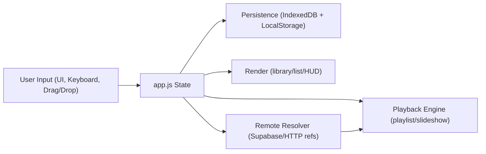

# Blend Player v5 (slideshow-playlist-player.html)

Blend is a local-first, browser-based dual-layer media studio. It lets you run a **Playlist layer** (video/audio) and a **Slideshow layer** (image/video) at the same time, then blend them live with independent controls.

> This README documents the self-contained `[blend.v5.0.11 - Copy](https://github.com/mytech-today-now/slideshow-playlist-player.html/tree/main/src/blend.v5.0.11%20-%20Copy)` project in this directory. Run project commands from the directory containing this file and `package.json`.
>
> The neighboring `../blend.v5.0.11/` is a separate version folder. This folder is a standalone review target. Confirm its release destination before copying changes to another version.

## Table of Contents

- [Project Description](#project-description)
- [Current Version Information](#current-version-information)
- [Screenshots](#screenshots)
- [Quick Start](#quick-start)
- [Installation](#installation)
- [Running Locally](#running-locally)
- [Feature Matrix](#feature-matrix)
- [Detailed Feature Documentation](#detailed-feature-documentation)
- [User Guide](#user-guide)
- [Playback Controls](#playback-controls)
- [Keyboard Shortcuts](#keyboard-shortcuts)
- [Touch Controls](#touch-controls)
- [Accessibility](#accessibility)
- [Mobile Usage](#mobile-usage)
- [Desktop Usage](#desktop-usage)
- [Supported File Types](#supported-file-types)
- [Import/Export Formats](#importexport-formats)
- [Configuration Reference](#configuration-reference)
- [Data Persistence, Storage, and Privacy](#data-persistence-storage-and-privacy)
- [Architecture Documentation](#architecture-documentation)
- [Browser Compatibility](#browser-compatibility)
- [What Works](#what-works)
- [Known Limitations](#known-limitations)
- [Known Issues](#known-issues)
- [Troubleshooting Guide](#troubleshooting-guide)
- [FAQ](#faq)
- [Developer Documentation](#developer-documentation)
- [Future Development and Recommended Improvements](#future-development-and-recommended-improvements)
- [Changelog Reference](#changelog-reference)
- [Contributing](#contributing)
- [Credits](#credits)
- [License](#license)

## Project Description

### What the application does

Blend combines two synchronized media layers:

- **Playlist layer**: video + audio sequence
- **Slideshow layer**: image + video sequence

You can play both at once, mix visibility using a blend slider, and control each layer volume plus a master volume.

### Primary use cases

- Event and venue playback
- DJ/VJ-style ambient media mixing
- Local/private playback sessions
- Curated “experience” packages (playlist + slideshow + settings)

### Target users

- Creators and curators
- Event operators
- Users who want local-first playback without uploading files

### Key capabilities

- Local media library with folder/file/url import
- Multi-experience catalog (save/switch/import/export experiences)
- List editing (sort, shuffle, reverse, drag reorder)
- Deep links and sharing links
- Supabase-based remote media URL resolution (public + signed private URLs)
- PWA shell with split service worker caches, offline fallback, and alias routing

### Browser-based architecture

- No framework runtime dependency
- ES modules + browser-native APIs
- IndexedDB + LocalStorage persistence
- Local-only operation for local files (network used only for configured remote features)

## Current Version Information

- **Active project root for this checkout:** this directory (`blend.v5.0.11 - Copy`)
- **Authoritative app entry:** `index.html`
- **Compatibility redirect entry:** `slideshow-playlist-player.html`
- **Runtime app version string in code/UI:** `5.0.11`
- **Cache/app shell version key:** `20261019-v5.0.11-session-and-recovery`
- **Release and version history:** see [CHANGELOG.md](CHANGELOG.md) and [VERSIONS.md](VERSIONS.md).

The web manifest and PWA icons are served from the app directory: publish `manifest.webmanifest`, `icon.svg`, and `icon-maskable.svg` alongside `index.html`. Their URLs use the shared asset version so an installed app refreshes stale manifest and icon entries after deployment.

Latest source location:

- [Repository root](https://github.com/mytech-today-now/slideshow-playlist-player.html)
- [Canonical upstream release folder](https://github.com/mytech-today-now/slideshow-playlist-player.html/tree/main/src/blend.v5.0.11%20-%20Copy)

## Screenshots

> Placeholder references (replace with real captures as available).


## Quick Start

1. Open `index.html` from a local server started in this project directory.
2. Press `C` (or click the gear icon) to open the configuration panel.
3. Add media using one of these actions:
   - `Add Files` for individual files
   - `Add Folder` for recursive folder scan
   - `Add URL` for `http(s)`, `supabase://`, or legacy `ipfs://` references
4. Select items in Media Library and add to Playlist/Slideshow.
5. In the configuration panel, press `Play` and adjust `Blend`, volume, and transitions.

## Installation

No build step is required for normal playback.

For testing and development, run these commands from this project root:

```bash
npm install
```

## Running Locally

### Option A: serve this project folder directly

```bash
npx serve -l 5173 --cors
```

Then open:

```text
http://localhost:5173/index.html
```

### Option B: serve from the parent repository root

```bash
python -m http.server 5173
```

Then open:

```text
http://localhost:5173/src/blend.v5.0.11%20-%20Copy/index.html
```

## Feature Matrix

| Area | Capability | Status | Notes |
|---|---|---|---|
| Playback | Dual-layer playback | Yes | Playlist + Slideshow layers run independently |
| Playback | Blend opacity control | Yes | Live slider + keyboard (`[` / `]`) |
| Playback | Master + per-layer volume | Yes | Playlist, Slideshow, Master |
| Playback | Experience playback modes | Yes | Loop, Stop at End, Go to Next Experience |
| Playback | Playlist order | Yes | Sequential or random; sequential by default |
| Playback | Slideshow order | Yes | Sequential or random; sequential by default |
| Playback | Fullscreen | Browser-dependent | `requestFullscreen()` on viewport; playback controls remain available when fullscreen cannot start. Mobile device behavior is unverified. |
| Library | Add files | Browser-dependent | File System Access API where available, otherwise file-input fallback. Named iOS and Android import/persistence runs are unverified. |
| Library | Add folder (recursive) | Browser-dependent | Directory picker + supported input fallback; Add Files remains available when folder selection is unavailable. Mobile device behavior is unverified; depth limit 6; 250 supported media files per selection; native directory-picker scans stop after 2,000 visited entries |
| Library | Add URL | Yes | `http(s)`, `supabase://`, legacy `ipfs://` refs |
| Library | Drag-and-drop import | Yes | Files/directories/list files |
| Library | Search/filter/sort | Yes | Type + source filters, worker projection for large sets |
| Lists | Playlist editor | Yes | Drag reorder, sort, shuffle, reverse, import/export |
| Lists | Slideshow editor | Yes | Per-image duration, per-video include-audio toggle |
| Lists | Playback timeline | Yes | Per-item start/end/duration, cumulative timing, and URL health for both layers |
| Lists | Unavailable item preservation | Yes | Experience import can keep “Not Available” placeholders |
| Persistence | IndexedDB state | Yes | Library, lists, settings, experiences, thumbnails, dir handles |
| Persistence | LocalStorage state | Yes | Active experience, banners, consent, runtime overrides |
| Import/Export | List JSON/TXT import-export | Yes | `.json`, `.jsonl`, `.txt`, `.md` import |
| Import/Export | Experience JSON import-export | Yes | Schema `player.blend.experience.v2` |
| Remote Media | Supabase URL resolution | Yes | Public object URLs + signed private URLs |
| Remote Playlists | Public Git catalog browsing | Yes | Separate unauthenticated GitHub or Bitbucket reads and local import |
| Remote Playlists | User-owned Git read and publish | Partial | GitHub read and SHA-guarded publish; Bitbucket read and review only while atomic writes are undocumented |
| Sharing | Deep links | Yes | `exp`, `layer`, `item`, optional `autoplay` |
| Sharing | Social share menu | Yes | Native share, copy, and platform links |
| PWA | Service worker shell cache | Browser-dependent | Desktop Chromium and focused Firefox offline-shell reloads are covered; the WebKit smoke records an explicit offline-navigation skip. iOS/Android installation and offline reload with saved media are unverified. Media/range requests bypass cache. |

## Detailed Feature Documentation

### Slideshow Features

- Supports **images** and **videos**.
- Mixed slideshow media is supported.
- Manual navigation via viewport arrows and keyboard (`←`/`→` or `J`/`L`).
- Order can be set to **Sequential** or **Random** in Settings / Configuration; Sequential is the default.
- Per-item controls in Slideshow list:
  - Image: `displayDuration` (seconds)
  - Video: `includeAudio` toggle
- Transition system includes:
  - 17 transition effects
  - weighted effect selection
  - randomized or ordered sequencing
  - max heavy effects in a row
  - duration and overlap controls
  - optional FPS monitor + auto quality adjustment

### Playlist Features

- Supports **video** and **audio**.
- Mixed playlist media is supported.
- Playback controls: Prev / Play-Pause / Next / Stop.
- Seek 10%-90% with keys `1`-`9` (active playlist video).
- Order can be set to **Sequential** or **Random** in Settings / Configuration; Sequential is the default.
- Queue/list management:
  - shuffle, reverse, sort
  - drag reorder
  - remove item with undo toast

### Playback Timeline and Shared URL Analysis

- Every Playlist and Slideshow row shows start, end, item duration, cumulative running time, and a compact accessible SAFE / WARNING / OVER LIMIT link-health badge. Exact URL measurements remain available in the Share URL dialog and badge tooltips rather than crowding every row.
- The timelines run independently but share one playback clock. A URL checkpoint serializes every item that has started in both layers at that time, including completed items.
- The timeline summary distinguishes concurrent **session runtime** from **total media** (the sum of all image/video/audio contributions across both layers).
- URL lengths are measured from the real compact compressed share payload, not a byte estimate. Measurements are cached and scheduled incrementally so large lists remain responsive.
- Media duration is discovered from video/audio metadata during import when possible, refreshed when a local file changes, and rechecked during playback. Media with an unknown duration clearly reports unknown downstream timing until metadata becomes available. Zero-duration items are retained and serialize at their shared start checkpoint.

### Import Features

#### Images

- Drag-and-drop: Yes
- File picker: Yes
- Folder import: Yes
- Batch import: Yes
- URL import: Yes (`http(s)`, `supabase://`, legacy `ipfs://`)
- JSON import: Yes (via list/experience imports)

#### Videos

- Drag-and-drop: Yes
- File picker: Yes
- Folder import: Yes
- Batch import: Yes
- URL import: Yes (`http(s)`, `supabase://`, legacy `ipfs://`)
- JSON import: Yes

#### Audio

- Drag-and-drop: Yes
- File picker: Yes
- Folder import: Yes
- Batch import: Yes
- URL import: Yes (`http(s)`, `supabase://`, legacy `ipfs://`)
- JSON import: Yes

#### Playlists and Lists

- List import supports `.json` / `.jsonl` / `.txt` / `.md`.
- Active list target can be Playlist or Slideshow.
- Import behavior supports `Append` or `Replace current list`.
- List export supports:
  - JSON (`player.blend.list.v1`)
  - `.txt` (quoted path/reference per line)

#### Experiences

- Experience import supports `.json` (schema includes `experience` payload)
- Experience export produces timestamped JSON with settings snapshot, media library snapshot, and playlist/slideshow snapshots.
- Local list and experience imports accept files up to 10 MiB. This matches the existing shared-experience download ceiling and is about 2,200 times the checked-in 4,643-byte legacy experience fixture. JSON nesting is limited to 64 levels, any array to 10,000 items, all arrays together to 50,000 items, any object to 5,000 properties, and all objects together to 750,000 properties; text and JSONL imports allow up to 100,000 lines and 10,000 imported entries. Larger or structurally excessive files are rejected before list or experience changes; files are never silently truncated. Exports remain unchanged.

#### External Sources

Supported external reference forms:

- `https://...`
- `supabase://bucket/path/to/object`
- `bucket/path/to/object` shorthand (resolved via default bucket rules)
- legacy `ipfs://CID/...` (mapped by resolver rules)

### Import workflows (step-by-step)

#### Add Files

1. Open config panel.
2. Click `Add Files`.
3. Select media files.
4. Files appear in Media Library.

#### Add Folder

1. Open config panel.
2. Click `Add Folder`.
3. Choose a folder.
4. App recursively scans (up to configured depth) and imports supported media.

#### Add URL

1. Open config panel.
2. Click `Add URL`.
3. Paste one or more references (space/comma separated).
4. App validates and stores resolvable media references.

#### Drag-and-drop to Media Library

1. Drag files/folders from OS to Media Library grid.
2. Supported items are imported.
3. Dropped directories are scanned recursively.

#### Drag-and-drop list file into Playlist/Slideshow

1. Drag `.txt`/`.md`/`.json`/`.jsonl` file onto list editor.
2. List entries are parsed and imported into that list.
3. Missing paths can be resolved later.

#### Resolve missing paths

1. After import, click `Resolve now` or `Resolve missing paths...`.
2. Choose a folder.
3. App scans and matches missing entries by basename.

## User Guide

### Loading Media

- Use `Add Files` for one-off selection.
- Use `Add Folder` for event/session content batches.
- Use `Add URL` for remote references.
- Use source filters (`All`, `Local`, `URL`) to manage mixed libraries.

### Creating Slideshows

1. Select `Images`/`Video`/`All` in library filters as needed.
2. Multi-select media.
3. Click `Add Selected -> Slideshow`.
4. Set image durations and video `Include audio` options in the list.

### Creating Playlists

1. Select `Audio`/`Video` in library filters.
2. Multi-select media.
3. Click `Add Selected -> Playlist`.
4. Reorder/sort/shuffle as needed.

### Managing Media

- Search by filename/path.
- Sort Media Library by name/path/size/type/date/duration/metadata.
- Remove selected items from library.
- `Clear View` removes unreferenced library entries while preserving items used by saved experiences.
- `Remove Stale` deletes entries marked inaccessible.

### Saving Configurations

- Most edits are auto-saved to IndexedDB after a brief debounce. App-controlled experience changes wait for the current dirty revision to commit.
- Experience changes are persisted automatically.
- Active experience id is also stored in LocalStorage.
- If saving fails, the accessible status says: “Changes are not saved yet. Retry or export a backup before closing.” Use **Retry** or **Export Backup** to recover the retained edit.
- Browser shutdown may interrupt a pending save. Any final `pagehide` flush is best effort; reopen Blend to confirm the latest state was saved.

### Exporting Data

From `Export...`:

- Export list JSON
- Export list TXT
- Export media library JSON
- Export full experience JSON

### Importing Data

Remote `storageExperience` downloads accept JSON media types and are streamed with a 15-second deadline and a 10 MiB maximum. The byte limit is counted from the response body rather than trusted from `Content-Length`. This download deadline starts after URL resolution, which keeps its own signing timeout. Failed downloads keep their share URL available for retry; successful imports remove the share parameters.

- `Import List...` imports list entries into active list.
- `Experience -> Import` imports one or more experience JSON files.

### Browsing a Public Git Playlist Catalog

Open Configuration and enter the provider, owner or workspace, repository, branch, and catalog directory. Blend does not select a provider or repository for you. Save the settings, fetch the catalog, then choose a playlist to import it into the local Playlist. Import follows the current append/replace setting; replace asks for confirmation.

The catalog must use the format and safe media-reference subset described in [GIT_PLAYLIST_STORAGE_DESIGN.md](GIT_PLAYLIST_STORAGE_DESIGN.md). Public reads require no credentials. The reader does not commit changes, connect a private repository, or change the remote catalog. Public content and its Git history may remain accessible after the current catalog entry is removed.

### Connecting and Publishing a Git Playlist

The **Connect and publish your playlist** section uses the user's own GitHub or Bitbucket Cloud token and sends requests directly to the fixed provider API origin. Enter the provider, owner or workspace, repository, branch, repository-relative `.json` path, and token. Connect verifies repository visibility and read access with GET requests. GitHub supports reviewed writes protected by the file SHA. Bitbucket reads and reviews are available, but Blend pauses branch writes because the documented Source API does not promise an atomic compare-and-set condition.

Reading is a separate action. Blend validates the remote JSON and shows the sanitized playlist before the user chooses **Import read playlist into Blend**. For GitHub, **Review local playlist for publishing** displays the destination and exact allowlisted JSON; a checkbox and **Publish reviewed playlist** action confirm the write. Bitbucket reviews show the exact outgoing JSON and observed branch revision, but the publish action stays disabled. Use **Download reviewed JSON copy** to save a copy only when you choose. Only public HTTPS media URLs with supported media extensions are accepted. Local paths, private or signed URLs, credentials, and arbitrary app metadata are excluded or rejected.

Use a GitHub fine-grained personal access token limited to the intended repository, with Contents read for reads and Contents write for publishing. For Bitbucket Cloud, use a repository access token with Repository Read to connect and read playlists; Blend currently makes no Bitbucket write request. A Bitbucket repository access token is tied to that repository. GitHub browser requests omit the API-version header because its published CORS allowlist does not include it; GitHub currently defaults such requests to API version `2022-11-28`. Provider docs: [GitHub Contents API](https://docs.github.com/en/rest/repos/contents), [GitHub REST CORS](https://docs.github.com/en/rest/using-the-rest-api/using-cors-and-jsonp-to-make-cross-origin-requests), [GitHub API versions](https://docs.github.com/en/rest/about-the-rest-api/api-versions), [Bitbucket source API](https://developer.atlassian.com/cloud/bitbucket/rest/api-group-source/), [Bitbucket CORS](https://developer.atlassian.com/cloud/bitbucket/rest/intro/), and [Bitbucket repository access tokens](https://support.atlassian.com/bitbucket-cloud/docs/repository-access-tokens/).

Credentials stay in memory by default. **Remember on this device** explicitly saves a provider-tagged Git token in separate LocalStorage on Blend's origin, which scripts on that origin can read; LocalStorage is not a secure vault. Blend's consented analytics loader and remembered Git credentials or opted-in Supabase sessions use one cross-tab browser lock and cannot be active together. If analytics already holds the lock in this or another Blend tab, a requested Git or Supabase connection stays available in memory and the credential is not saved. To switch from analytics to remembered credentials, turn analytics off, close the other Blend tabs, reload, and connect again with the relevant remember control selected. If the browser cannot provide the shared lock, analytics and requested credential persistence fail closed while session-only Git and Supabase use remains available. Forget credential removes a remembered Git browser copy and clears the current Git connection; it does not revoke the provider token or change analytics consent. Disconnect clears only the in-memory Git token. Use the provider links in Configuration to revoke a Git token. Published files and Git history may be visible to repository readers. GitHub updates use the reviewed file SHA and surface conflicts. Bitbucket publishing is paused until its API documents an atomic condition for branch updates.

### Optional live-provider smoke verification

The opt-in browser smoke tests live provider CORS and responses. The normal regression and E2E suites remain network-free unless you explicitly provide the smoke configuration. Use a separate private repository for each provider. Each repository slug must start with `blend-smoke-` and contain a valid fixture playlist at `blend-smoke/playlist.json`; the smoke never creates or deletes repositories and refuses to publish if GitHub does not report the repository as private.

Create a harmless fixture with one public HTTPS media URL, for example:

```json
{
  "schema": "player.blend.list.v1",
  "type": "playlist",
  "name": "Disposable smoke fixture",
  "description": "",
  "order": ["fixture-a"],
  "items": [{
    "id": "fixture-a",
    "path": "https://example.com/fixture.mp3",
    "sourceUrl": "https://example.com/fixture.mp3",
    "pathKind": "remote",
    "name": "fixture.mp3",
    "type": "audio",
    "order": 0
  }]
}
```

Use a GitHub fine-grained token restricted to the disposable repository with Contents read and write. Use a Bitbucket repository token with Repository Read only. Enter tokens at a hidden secure prompt in a private PowerShell session; the smoke runner reads them from process environment and does not print them. Set the repository coordinates and exact confirmation for the private repository. GitHub writes require confirmation before any publish; Bitbucket's smoke is read-only.

```powershell
function Set-BlendSmokeToken($Name) {
  $secure = Read-Host "Synthetic token for $Name" -AsSecureString
  $pointer = [Runtime.InteropServices.Marshal]::SecureStringToBSTR($secure)
  try { Set-Item -Path "Env:$Name" -Value ([Runtime.InteropServices.Marshal]::PtrToStringBSTR($pointer)) }
  finally { [Runtime.InteropServices.Marshal]::ZeroFreeBSTR($pointer); $secure.Dispose() }
}

$env:BLEND_GITHUB_SMOKE_OWNER = 'YOUR_GITHUB_OWNER'
$env:BLEND_GITHUB_SMOKE_REPOSITORY = 'blend-smoke-github-unique'
$env:BLEND_GITHUB_SMOKE_BRANCH = 'main'
$env:BLEND_GITHUB_SMOKE_CONFIRM = "I_CONFIRM_DISPOSABLE_PRIVATE_REPOSITORY:$($env:BLEND_GITHUB_SMOKE_OWNER)/$($env:BLEND_GITHUB_SMOKE_REPOSITORY)"
Set-BlendSmokeToken BLEND_GITHUB_SMOKE_TOKEN

$env:BLEND_BITBUCKET_SMOKE_WORKSPACE = 'YOUR_BITBUCKET_WORKSPACE'
$env:BLEND_BITBUCKET_SMOKE_REPOSITORY = 'blend-smoke-bitbucket-unique'
$env:BLEND_BITBUCKET_SMOKE_BRANCH = 'main'
$env:BLEND_BITBUCKET_SMOKE_CONFIRM = "I_CONFIRM_DISPOSABLE_PRIVATE_REPOSITORY:$($env:BLEND_BITBUCKET_SMOKE_WORKSPACE)/$($env:BLEND_BITBUCKET_SMOKE_REPOSITORY)"
Set-BlendSmokeToken BLEND_BITBUCKET_SMOKE_TOKEN

npm run test:git-provider-smoke
```

The GitHub check connects and reads the fixture, publishes a harmless synthetic list, reads it back, checks that a stale review is rejected, then restores and verifies the original validated fixture. Cleanup restores file content but cannot erase commits from Git history. If a publish response is uncertain, the smoke reads the repository before any restoration attempt; it stops if the remote content is not one of the known smoke states. Inspect the disposable repository before retrying if cleanup cannot be verified. The Bitbucket check verifies only repository, branch, and playlist reads; it sends no write request.

Output contains only provider, operation label, method, HTTP status, and a stable sanitized outcome. It omits headers, URLs, repository names or paths, response bodies, and token values. The fixture web server does not inherit smoke environment variables. No account or token is configured by default, so both provider checks are reported as skipped. To clear the current PowerShell session after a run, remove the `BLEND_GITHUB_SMOKE_*` and `BLEND_BITBUCKET_SMOKE_*` environment variables. After verification, delete only the disposable repositories and revoke only the synthetic tokens.

To exercise a read-only GitHub token manually, scope a separate synthetic token to Contents read for only its disposable repository, connect with it in Blend, review a harmless playlist, and confirm that publish returns a sanitized permission error without changing the repository. Review the token's scope in the provider settings; this smoke does not inspect or certify account-wide permissions. Do not run a least-privilege experiment against a production playlist.

### Playback Controls

- Open the configuration panel with the gear or `C` to access the playback toolbar for both layers.
- Blend slider adjusts slideshow opacity over playlist.
- Volume controls include Playlist, Slideshow, and Master (+ mute).

### Best Practices

- Keep local and remote assets separated using source filters.
- Export full experience JSON as a backup before major edits.
- For large libraries, use folder organization and list-specific curation.
- Use `Remove Stale` regularly after moving/renaming local files.

### Large Library Performance Tips

- Library/list UIs are virtualized; keep search/filter narrowed during heavy curation.
- Worker-based library projection kicks in for large collections (threshold in code: 800 items).
- Thumbnail cache is bounded; avoid rapid, repeated full-library resorting during playback.
- Split very large sets across multiple experiences for faster switching and safer backups.

### Backup Recommendations

- Regularly export Full Experience JSON and Media Library JSON.
- Keep exported files in versioned backups.

## Playback Controls

Open the configuration panel with the gear or `C` to use the playback toolbar.

| Control | Description |
|---|---|
| `Prev` | Previous item/layer progression |
| `Play/Pause` | Toggle both layers. **Pause** freezes the audio/video and the slideshow at their exact current positions; **Play** after a pause resumes both from precisely where they left off (video/audio time, image-display countdown, and Ken Burns progress are all preserved). |
| `Next` | Next item/layer progression |
| `Stop` | Fully stops both layers, resets to a blank/black screen, and rewinds to the first playlist and slideshow item. **Play** after a Stop restarts the whole experience from the beginning. |
| `Blend` | Set slideshow opacity over playlist |
| `Fullscreen` | Toggle viewport fullscreen |
| `Mute` | Toggle master mute |
| `Master Volume` | Global volume multiplier |

**Transport contract**

- `Playing → Pause → Play` = resume exactly where you left off.
- `Playing → Stop → Play` = start over at the very beginning of the playlist and slideshow.

## Keyboard Shortcuts

| Shortcut | Action |
|---|---|
| `Space` / `K` | Play/pause both layers (resumes from the exact paused position) |
| `S` | Stop — reset to black and rewind to the beginning |
| `Left` / `J` | Previous |
| `Right` / `L` | Next |
| `[` / `]` | Blend opacity -/+ 10% |
| `C` | Toggle config panel |
| `i` button | Open the Information dialog (About myTech.Today + README) from the config header |
| `F` | Toggle fullscreen |
| `M` | Toggle master mute |
| `1`-`9` | Seek 10%-90% in current playlist video |
| `/` | Focus library search |
| `Alt+S` | Open Media Library sort menu |
| `Ctrl+A` / `Cmd+A` | Select all visible Library media, or all items in the active list editor |
| `Ctrl+Click` / `Cmd+Click` | Toggle an item without clearing the current selection |
| `Shift+Click` / `Shift+Arrow` | Select a contiguous range |
| Arrow keys | Move keyboard focus through a Library or active list editor |
| `Space` (focused Library/list row) | Toggle that row’s selection |
| `Delete` / `Backspace` | Remove all selected list items, or the focused item when nothing else is selected |
| `?` | Open help modal |
| `Esc` | Clear a selection first; then close menus/modals/panel |

## Touch Controls

Implemented touch-friendly behavior:

- Large touch targets in controls and lists
- Pointer-based list reordering fallback (long-press/drag behavior)
- Dedicated selection/deletion controls remain available without modifier keys

Swipe gestures are unavailable. Use the Previous and Next buttons or keyboard arrows. Adjust blend opacity with the Blend slider.

## Accessibility

Implemented accessibility-oriented behavior includes:

- Skip link (`Skip to controls`) for keyboard users.
- ARIA labels/roles across transport, dialogs, listboxes, and status regions.
- The active Playlist and Slideshow rows expose `aria-current="true"` while their media is loaded for playback; row selection remains independent.
- Keyboard-first operation for core playback and editing workflows.
- Visible focus states and assistive announcement regions (`aria-live`).
- Reduced-motion awareness in transition manager via `prefers-reduced-motion`.

The Playwright DOM checks in `tests/e2e/list-playback-accessibility.e2e.spec.mjs` run in Chromium and cover the current-row marker on play and through next/previous navigation, independent selection, pause/stop, Playlist/Slideshow switching, unavailable-item descriptions, virtualization, and experience switching. These assertions do not capture speech output. Manual screen-reader review of the current-playback row state is still outstanding.

## Mobile Usage

- Mobile core playback and editing have not been verified on named physical devices; iOS Safari and Android Chrome support remains partial.
- iOS install guidance is provided through the install/help banner, but mobile PWA installation and offline reload with saved media are unverified.
- Folder and fullscreen APIs vary by browser. If folder selection is unavailable or denied, use **Add Files** or continue with saved items; playback controls remain available when fullscreen cannot start.
- See [Browser Compatibility](#browser-compatibility) for the exact mobile device acceptance paths that remain unverified.

## Desktop Usage

- Best overall experience on Chromium browsers.
- Full File System Access APIs improve folder workflows and persistence.
- Keyboard-first workflows are fully supported.

## Supported File Types

### Image Formats

| Format | Supported | Notes |
|---|---|---|
| `.jpg` / `.jpeg` | Yes | Browser decode support required |
| `.jfif` | Yes | JPEG container variant; treated as image media |
| `.png` | Yes |  |
| `.apng` | Yes | Animated PNG decode behavior is browser-dependent |
| `.webp` | Yes |  |
| `.gif` | Yes | Animated decode behavior is browser-dependent |
| `.svg` | Yes | Rendered as image media |
| `.bmp` | Yes | Uncompressed/legacy bitmap support varies by engine |
| `.ico` | Yes | Treated as image media; icon size support varies |
| `.avif` | Yes | Browser codec support required |
| `.heic` / `.heif` | Yes | Browser codec support is inconsistent across engines |

### Video Formats

| Format | Supported | Notes |
|---|---|---|
| `.mp4` | Yes |  |
| `.m4v` | Yes | Treated as `video/mp4` |
| `.mov` / `.qt` | Yes | Explicit QuickTime MIME handling in code |
| `.mkv` | Yes | Browser codec support varies |
| `.webm` | Yes |  |
| `.ogv` | Yes |  |
| `.avi` | Yes | Browser codec support varies |

### Audio Formats

| Format | Supported | Notes |
|---|---|---|
| `.mp3` | Yes |  |
| `.m4a` | Yes |  |
| `.wav` | Yes |  |
| `.ogg` | Yes |  |
| `.flac` | Yes | Browser support varies |
| `.aac` | Yes | Browser support varies |

### Playlist/List Import Formats

| Format | Supported | Notes |
|---|---|---|
| `.json` | Yes | List/library/experience-compatible parsing paths |
| `.jsonl` | Yes | One JSON record per line |
| `.txt` | Yes | Quoted paths/URLs and delimiter parsing |
| `.md` | Yes | Markdown list parsing + path extraction |

### Configuration and Persistence Formats

| Format | Supported | Notes |
|---|---|---|
| IndexedDB object stores | Yes | Main persistent application state |
| LocalStorage key-values | Yes | UI/session flags, consent, runtime overrides |
| Runtime config JSON (`blend-runtime-config-v1`) | Yes | Operator-managed override path for Supabase/runtime settings; preserved by Clear Browser Storage |

### Export Formats

| Format | Supported | Notes |
|---|---|---|
| List JSON (`player.blend.list.v1`) | Yes | Playlist or Slideshow export |
| List TXT | Yes | Quoted path/reference lines |
| Media Library JSON (`player.blend.library.v1`) | Yes | Current sorted order exported |
| Experience JSON (`player.blend.experience.v2`) | Yes | Settings + library + both lists |

## Import/Export Formats

### List JSON (`player.blend.list.v1`)

Includes:

- `version`, `schema`, `type`
- list metadata (`name`, `description`, `createdAt`)
- project metadata (`project`, `exportedAt`)
- `order` array and `items[]`

### Library JSON (`player.blend.library.v1`)

Includes:

- sorted `items[]`
- `sort` metadata (key/dir)
- `order` array

### Experience JSON (`player.blend.experience.v2`)

Includes:

- experience metadata (`id`, `name`, `project`)
- exported settings snapshot
- library snapshot
- playlist + slideshow snapshots

Import behavior rules:

- `Append` adds items.
- `Replace current list` replaces active list, but restores previous list if nothing valid imports.
- Missing items can be resolved via folder scan.

## Configuration Reference

### Global/User Settings

| Setting | UI Control | Stored | Notes |
|---|---|---|---|
| Import behavior | `#import-behavior` | IndexedDB settings | `append` or `replace` |
| Theme | `#theme-mode` | IndexedDB settings | `auto`, `dark`, `light` |
| Effect intensity | `#effect-intensity` | IndexedDB settings | Ken Burns intensity multiplier |
| Experience playback mode | `#experience-playback-mode` | IndexedDB settings | `loop`, `stop`, `next-experience` |
| Playlist order | `#playlist-order` | IndexedDB experience settings | `sequential` (default) or `random`; Previous follows random history |
| Slideshow order | `#slideshow-order` | IndexedDB experience settings | `sequential` (default) or `random`; Previous follows random history |
| Loop experience catalog | `#loop-experience-catalog` | IndexedDB settings | Wrap to first experience |
| Default image duration | `#default-duration` | IndexedDB settings | Seconds |
| Transition duration | `#transition-duration` | IndexedDB settings | 200-10000 ms |
| Transition overlap | `#transition-overlap` | IndexedDB settings | 0-10000 ms |
| Transition randomize order | `#transition-randomize-order` | IndexedDB settings | Weighted random vs ordered |
| Max heavy transitions in row | `#transition-max-heavy` | IndexedDB settings | 0-8 |
| Enabled transitions + weights | Transition picker | IndexedDB settings | Per-effect enable + weight |
| Auto quality adjust | `#quality-auto-adjust` | IndexedDB settings | FPS-driven quality tier |
| Show FPS monitor | `#show-transition-fps` | IndexedDB settings | HUD monitor |
| Resume on load | `#resume-on-load` | IndexedDB settings | Explicit opt-in restores saved positions paused; select Play to start media |
| Auto verify on startup | `#auto-verify` | IndexedDB settings | Verifies file handles |
| Analytics consent | `#analytics-consent` | LocalStorage + runtime | Also gated by browser privacy signals, credential state, and the cross-tab execution lock |
| Supabase default bucket | `#supabase-default-bucket` | IndexedDB settings | Default storage bucket |
| Signed URL TTL | `#supabase-signed-url-ttl` | IndexedDB settings; 3,600 seconds by default, with owner-selected overrides | Seconds |
| Require auth for private media | `#private-media-auth-required` | IndexedDB settings | Controls auth expectation |
| Public Git catalog | `#git-catalog-*` controls | LocalStorage `blend-public-git-catalog-v1` | Stores provider and public repository location only; never stores credentials |
| User Git repository | `#git-playlist-*` controls | LocalStorage `blend-git-playlist-repository-v1` | Provider, repository, branch, and path only |
| Remembered Git credential | `#git-playlist-remember` | LocalStorage `blend-git-playlist-credential-v1` | Provider-tagged token only after explicit opt-in and shared-lock acquisition; remains session-only while analytics is active |
| Playlist volume | `#vol-playlist` | IndexedDB settings | 0.0-1.0 |
| Slideshow volume | `#vol-slideshow` | IndexedDB settings | 0.0-1.0 |
| Master volume | `#vol-master` | IndexedDB settings | 0.0-1.0 |

Random chooses among playable items and excludes the current item when another playable choice exists; a one-item playable list stays on that item. Previous returns through recorded random navigation history for each layer.

Older experience exports that omit either layer order setting load as Sequential. Unknown values also normalize to Sequential.

## Data Persistence, Storage, and Privacy

### IndexedDB stores

Database: `player-blend-v1` (version `5`)

Stores:

- `library`
- `playlist`
- `slideshow`
- `settings`
- `experiences`
- `thumbnails`
- `dirHandles`
- `aliases`
- `aliasMeta`

When the stored database version is newer than this app's requested version, Blend opens it without requesting a downgrade and checks the required object stores and key paths before startup. Compatible additive schemas remain usable; an incompatible schema stops startup and leaves the saved database unchanged.

### LocalStorage keys used

- `blend-active-experience-id`
- `blend-install-banner-hidden-v4`
- `blend-welcome-v4`
- `blend-analytics-consent-v1`
- `blend-share-mastodon-instance-v1`
- `blend-runtime-config-v1` (operator-managed connection settings; preserved by Clear Browser Storage)
- `blend-public-git-catalog-v1` (public Git provider, repository, branch, and path only; contains no credentials)
- `blend-git-playlist-repository-v1` (authenticated repository coordinates only; contains no credentials)
- `blend-git-playlist-credential-v1` (only after explicit opt-in to remember the Git token on this device)
- `blend-supabase-auth-session-v2` (only after opting in to save the session)
- `blend-debug-log-v1`

### Privacy and security notes

- Local media files are not uploaded by default.
- Browser-side path sanitization rejects control chars and `..` traversal.
- Remote references are validated and normalized.
- Public catalog reads remain unauthenticated and separate from the optional authenticated repository connection.
- Authenticated Git requests use fixed HTTPS GitHub and Bitbucket Cloud API origins, `credentials: "omit"`, `cache: "no-store"`, rejected redirects, stable sanitized errors, and authorization headers only. The service worker does not cache these cross-origin provider responses.
- The Git token stays in memory by default. Explicit remembering stores it separately from repository coordinates in `blend-git-playlist-credential-v1`. Scripts running on Blend's origin can read that browser storage. Disconnect clears memory; Forget credential also deletes the saved copy but does not revoke the token.
- Remote publishing uses a dedicated playlist allowlist. Local file paths, storage references, experience settings, library snapshots, credentials, and arbitrary metadata are not sent. The review displays the exact JSON. HTTPS URLs can still refer to tracking hosts or become private later, so review them before publishing.
- GitHub updates use the reviewed Contents blob SHA and a stale SHA returns a conflict. Bitbucket branch writes are disabled because the documented Source API does not promise atomic compare-and-set. After an uncertain GitHub submission, the review stays visible and Blend requires a successful remote read and comparison before allowing another attempt.
- Supabase sessions stay in memory by default. Selecting **Save session in this browser** explicitly saves only `access_token`, `refresh_token`, and `expires_at` under `blend-supabase-auth-session-v2`; the previous `v1` entry is removed and never restored. LocalStorage is not a secure vault: any same-origin script can read an opted-in session. If the shared browser lock is unavailable or held by analytics, Blend keeps the connection in memory for this tab and shows: “The connection is available for this tab only. Do not save credentials on this device.”
- Supabase refresh tokens have no fixed expiry and are normally single-use, with a default 10-second reuse interval. Project Auth settings can still end sessions through inactivity or maximum-lifetime rules. The current logout request uses Supabase's default global scope and can revoke refresh tokens for all sessions; already issued access tokens may remain valid until expiry. If the provider request fails, the interface distinguishes an unknown remote result from local storage cleanup, and it does not claim remote revocation. See [Supabase session documentation](https://supabase.com/docs/guides/auth/sessions) and [Supabase sign-out scopes](https://supabase.com/docs/guides/auth/signout).
- New private signed Storage URLs use a default TTL of 3,600 seconds (one hour). The owner-controlled Config value applies to newly issued URLs; the previous saved IndexedDB default of 1,209,600 seconds migrates once, while explicit overrides remain in effect. Signing out stops private playback and clears app-managed signed URLs from transient media references in the current tab while preserving portable `supabase://` references for retry after sign-in. Signed URLs are excluded from IndexedDB snapshots. The local-reset broadcast also triggers cleanup in peer tabs that receive it. This local cleanup does not revoke a copied URL. A copied URL keeps its own expiry, and Smart CDN may serve a cached response beyond token expiry until its cache duration ends. See [signed URL behavior](https://supabase.com/docs/guides/storage/serving/downloads) and [Smart CDN caching](https://supabase.com/docs/guides/storage/cdn/smart-cdn).
- To restore cross-reload access for a session, select **Save session in this browser** when connecting; that checkbox is the explicit acceptance of the LocalStorage disclosure. To return to tab-only access, sign out and reconnect with the checkbox cleared.
- Manual fresh-profile check: in a new browser profile, confirm no Supabase session key exists; connect synthetic access and refresh tokens with the checkbox cleared; verify neither token is saved, reload, and confirm private media remains gated while public/local playback still works. Then repeat with the checkbox selected, confirm only the documented fields are saved, and sign out to clear them. Keyboard to the checkbox and confirm its adjacent disclosure is announced by a screen reader without hover.
- Threat assumption: any script executing on this site can read an opted-in LocalStorage session. This describes the browser boundary and does not claim that this checkout contains an injection.
- Google Tag Manager is inserted only after affirmative consent, privacy-signal checks, empty and inspectable Git and Supabase credential storage, and acquisition of the cross-tab Web Lock. A remembered credential/session or unreadable storage state makes no analytics request. Analytics status text names the saved state without displaying credential values. This gate does not sandbox arbitrary same-origin scripts; any other code executing on the origin can still read LocalStorage. It describes a browser boundary and does not claim that this checkout contains an injection or that the vendor has read a token.
- If analytics has already been inserted, the app retains its lock until the document exits, even if the script fails or the user turns consent off. A later Git or Supabase remember attempt stays available in memory for that tab and does not persist while the lock is held. To save a token, turn consent off, close other Blend tabs, reload, and reconnect with the relevant remember control enabled. Forgetting a remembered credential can let analytics resume under the existing consent and privacy rules without the gate changing consent or disconnecting the provider session itself.

### Browser permissions

- Local file playback can require browser-granted read permission for stored file handles.
- On startup, auto-verify can mark entries as stale when handle access is no longer granted.
- Supabase private media access requires a valid API token/session in this tab or an explicitly saved session in this browser profile.

### Offline behavior

- Service worker caches the shell, static assets, docs, API/config responses, and alias metadata in separate versioned cache namespaces.
- Alias rules are stored durably in IndexedDB and mirrored into the service worker for offline-friendly friendly/legacy routes.
- Media and HTTP `Range` requests bypass Cache Storage and go to network/local handles.
- Remote media URLs still require connectivity unless a future explicit offline-media pack is added.

### Reset and cache management

Use **Clear Browser Storage** to remove browser-side data:

- IndexedDB data, including saved media access handles
- selected LocalStorage keys, including saved Supabase sessions, public Git catalog coordinates, user Git repository settings and any remembered Git credential, and any legacy session entry
- operator-managed runtime configuration (`blend-runtime-config-v1`) is retained, including Supabase endpoint, key, and bucket overrides, so configured service access can be restored after reset
- Blend service worker/cache entries across `blend-shell-*`, `blend-static-*`, `blend-docs-*`, `blend-api-*`, and `blend-alias-*`

Media files on disk are not deleted, and reset does not send a remote logout request. Before changing the saved local Supabase session or deleting IndexedDB, reset prepares a recovery snapshot of every database store except `thumbnails`. Thumbnail Blobs are derived previews; they are generated lazily from retained media handles, while unavailable sources use the existing media icon. Excluding this cache keeps the snapshot's thumbnail record and Blob-byte counts at zero, even for a large cache. Snapshot memory still scales with the user-authored records it protects.

If the recovery snapshot cannot be prepared, deletion does not begin and the current Blend state, saved data, and local Supabase session remain unchanged. The user sees: “Browser reset could not create a recovery copy. Your saved Blend data was kept; close other Blend tabs and retry.” After a snapshot succeeds, the local Supabase session is cleared and IndexedDB deletion begins. The in-memory screen is committed only after IndexedDB confirms deletion. If deletion fails or times out, the session is reported as removed and recovery of saved records is attempted before retry. A timed-out deletion may remove the database before recovery finishes, so the thumbnail cache may be empty afterward; the incomplete-reset message explicitly says the cache may be cleared. Previews can regenerate from retained handles when available. This is cache cleanup, not media-file loss, and the reset reports an incomplete outcome rather than success. The runtime configuration override is connection configuration rather than resettable player data, so the confirmation identifies it as preserved. If session storage cannot be fully cleared, Blend signs out in the current tab, reports that removal of all saved session data could not be confirmed, and keeps the other Blend data. A success message appears only after the requested local cleanup steps finish.

## Architecture Documentation

### Front-end architecture

- HTML shell (`index.html`) + CSS (`styles.css`) + JS modules.
- Main orchestration in `app.js`.
- Feature modules:
- `git-playlist-catalog.js`
- `git-playlist-storage.js`
- `transition-manager.js`
- `storage-url-resolver.js`
- `supabase-auth.js`
- `supabase-config.js`
- `drag-sort.js`
- `timeline-analysis.js`
- `logger.js`
- `pwa-config.js`
- `pwa-client.js`
- `alias-router.js`
- `alias-store.js`
- `alias-sync.js`

### Data flow



### State management

Single in-memory `state` object manages:

- library map + directory handles
- playlist/slideshow arrays
- list metadata
- settings
- experience catalog + active experience
- runtime playback position and history

### Event handling

- UI event handlers wired in `wireTransport`, `wireConfig`, `wireKeyboard`.
- Drag-and-drop supports internal reorder plus external files/directories/list imports.
- Playback completion handler coordinates end-of-experience behavior.

### Browser Technologies and APIs

| API / Technology | Usage |
|---|---|
| HTML5 / CSS3 / JS (ES Modules) | Core UI and application logic |
| IndexedDB | Persistent app data and thumbnails |
| LocalStorage | UI/session flags, consent, auth/session, runtime config |
| File System Access API | File and directory pickers, persistent handles |
| File input fallback | Browser fallback when File System Access unavailable |
| Drag and Drop API | OS file/folder drops and list imports |
| Media APIs (video elements, image elements, and media events) | Playback and slideshow rendering |
| Fullscreen API | Viewport fullscreen |
| Service Worker + Cache Storage | App shell caching |
| Web Share API | Native share sheet |
| Clipboard API | Copy link fallback |
| URL/History APIs | Deep links and cleaned auth hash |
| Web Animations API + CSS capabilities | Transition effects |
| `requestAnimationFrame` | Ken Burns and monitoring loops |
| `matchMedia` | Theme/reduced-motion and install logic |

### Dependencies

Runtime:

- No front-end framework dependency required for core app logic.
- External script in `index.html`:
- Google gtag script (`googletagmanager.com`) for analytics integration.

Remote services (optional/by configuration):

- Supabase Auth endpoints
- Supabase Storage public/signed URL endpoints

Dev/test (`package.json` in this project root):

- `@playwright/test`
- `esbuild`

## Browser Compatibility

| Browser | Support statement | Automated evidence | Limits |
|---|---|---|---|
| Chrome (desktop) | Primary desktop target | Full E2E suite is configured for Playwright Chromium | Chromium is not Google's branded Chrome build. A historical 189-test full run recorded 171 passes and 18 failures before the auth-failure smoke case; this is not a current result. |
| Edge (desktop) | Chromium-family behavior is expected | No branded Edge run | Edge-specific behavior is not independently verified. |
| Firefox (desktop) | Partial | Focused Playwright Firefox engine smoke for browser fallbacks, private-media expiry, atomic import recovery, save retry, and offline-shell reload | Engine-build evidence only; this does not certify every Firefox release or platform. |
| Safari (desktop) | Partial | Focused Playwright WebKit engine smoke for browser fallbacks, private-media expiry, atomic import recovery, save retry, and service-worker status | WebKit engine coverage is not a Safari application or iOS Safari run. Its offline-shell reload is explicitly skipped after an internal navigation error; fallback import save failures are announced as session-only. |
| iOS Safari | Partial | No iOS or mobile Safari run | Install guidance is provided; mobile picker, fullscreen, and PWA behavior remain unverified. |
| Android Chrome | Partial | No Android device run | Desktop Chromium results do not verify Android-specific behavior. |

Compatibility notes:

- CI runs the complete configured suite in Playwright Chromium and a bounded tagged smoke in Firefox and WebKit: browser fallbacks and picker limits, thumbnail and directory-visibility recovery, expired private-media authorization, atomic import recovery, and save retry. Firefox also runs the actual offline-shell reload. Playwright WebKit's offline-shell case is recorded as skipped after an internal offline-navigation error, while its service-worker status branch still runs. Each cross-engine result records its Playwright project and runtime engine version; the HTML report includes per-engine passed, failed, and skipped counts. CI verifies the report before uploading `playwright-report/`, including after a Playwright test failure. These are browser-engine results, not branded-browser or mobile-device runs.
- Before the Issue 09 smoke-matrix addition on 2026-10-13, `npm run test:e2e -- --list` selected 281 tests in 46 files. The current configured matrix lists 291 tests: 237 Chromium tests and 27 tagged smoke tests each in Firefox and WebKit. These are inventories, not assertion results. The same-day full `npm run test:e2e` attempt stopped before test execution with `Error: spawn EPERM`; Playwright reported “No tests.” The Issue 09 focused Firefox/WebKit run passed 49 tests and skipped 5, including the explicit WebKit offline-shell skip, and its report at `playwright-report/issue-09-20261013-final/` passed `node tests/e2e/verify-playwright-report.mjs` with `PLAYWRIGHT_HTML_OUTPUT_DIR` set to that folder. The full-suite browser E2E status remains unknown until the full configured suite runs in a supported environment. The earlier generated report at `playwright-report/issue-20-20261013-01/` also passed the report safety verifier.
- Historical local records have no verified run date: one full suite recorded 24 compatibility passes (8 per project) and 18 other Chromium failures (171 passed of 189); a focused compatibility run recorded 30/30 cases (10 per project) with Chromium 153.0.8010.12, Firefox 155.0, and WebKit 26.6; a Chromium PWA offline-shell run recorded 5/5 cases. These are historical browser-engine results, not a current baseline.
- These results describe Playwright browser-engine builds. They do not establish branded Chrome, Edge, Firefox, or Safari application coverage, or mobile-device coverage.
- No named iOS or Android device run is recorded. On both iOS Safari and Android Chrome, local import/save and playback; folder selection and its individual-file fallback; fullscreen; rotation; PWA install and offline reload with saved media; quota/permission recovery; and keyboard, touch, assistive-technology, and 200 percent text-zoom access remain **unverified**. Desktop engines and viewport sizes do not establish those device results.
- Record the device model, operating-system version, browser version, network state, workflow, and exact outcome before marking any mobile path verified.
- File-input fallback imports remain available in memory if browser storage rejects the selected file data. Blend reports that outcome as session-only and the files must be selected again after reload; it does not report a successful save.
- Actual media decode depends on browser codec support.
- HEIC/HEIF and some MKV/AVI/FLAC/AAC combinations may vary by browser/platform.

### Physical mobile-device review attempt (2026-10-16)

No iOS Safari or Android Chrome device session was available to this Windows runner; `adb` was unavailable for Android device enumeration. Device model, OS/browser versions, network state, and installation state were **Not run / not observed**. All mobile workflow outcomes below are **Not run**. No personal media or device app data was accessed or cleared.

| Workflow | iOS Safari | Android Chrome |
|---|---|---|
| Add Files / local import and save | Not run | Not run |
| Folder selection or individual-file fallback | Not run | Not run |
| Reload persistence | Not run | Not run |
| Synthetic media playback | Not run | Not run |
| Fullscreen | Not run | Not run |
| Rotation | Not run | Not run |
| PWA installation and offline reload with saved media | Not run | Not run |
| Quota and permission recovery | Not run | Not run |
| Keyboard and touch controls | Not run | Not run |
| Assistive technology | Not run | Not run |
| 200 percent text zoom | Not run | Not run |

### Bounded branded desktop smoke

This manual smoke is one short run per installed desktop browser, using the same disposable synthetic local video and a fresh browser profile. Start the local fixture server with `node tests/e2e/fixture-server.mjs` and open `http://127.0.0.1:4191/index.html`. If FFmpeg with `libx264` is available, generate a two-second fixture outside the checkout. Windows PowerShell example: `ffmpeg -hide_banner -loglevel error -f lavfi -i testsrc2=size=320x180:rate=24 -t 2 -an -c:v libx264 -pix_fmt yuv420p -movflags +faststart -y "$env:TEMP\issue12-synthetic.mp4"`; on macOS, use the same FFmpeg inputs/options with an output in the OS temporary directory. If that fixture cannot be made, mark video codec playback **Not run**; do not substitute personal media. Import the fixture with **Add Files**, add it to a list, play it, enter and exit fullscreen, wait for the service worker to control the page and the save status to settle, then use the browser's Network panel to go offline and reload. Record whether the shell loads and the imported item/list survive. If fullscreen is unavailable or rejected, check that the app announces the limitation and playback controls remain available; do not record fullscreen as passed. Restore network access and discard the temporary profile after the run.

Record the browser brand and exact version, operating-system version, date, network state, and the outcome of import/save, video decode/playback, fullscreen, offline reload, and local-state recovery. If a browser or step is unavailable, record **Not run** with the reason and keep that browser **Partial / unverified**; the checklist above is the fallback for completing the run later in that branded app. A Playwright engine result never fills a branded-app result. Use only synthetic media; do not use provider credentials, private media, or unrelated-origin data. Add product code and tests only after a specific branded-browser difference is reproduced.

Review-runner inventory (2026-10-13, Windows; executable product versions are installation metadata, not workflow results):

| Branded browser | Installed version | Manual workflow result |
|---|---|---|
| Google Chrome (desktop) | 155.0.8059.40 | Not run: Windows app-control approval timed out before the browser workflow; partial / unverified. |
| Microsoft Edge (desktop) | 155.0.4283.45 | Not run: no branded workflow was completed in this review; partial / unverified. |
| Safari (desktop) | Not installed on this Windows runner | Not run; partial / unverified. |

Review-runner attempt (2026-10-16): the host reported OS version `10.0.26300.9711`, DisplayVersion `26H2`, EditionID `Core`, and registry ProductName `Windows 10 Home`. Installed executable metadata reported Chrome `155.0.8059.82` and Edge `155.0.4283.45`; these are installation versions, not completed workflow results. A two-second synthetic H.264 High-profile, 320×180, `yuv420p` fixture was generated successfully and removed after the attempt. The CUA browser provider returned unavailable for both `chrome` and `edge`; Playwright channel launches for Chrome and Edge failed with `spawn EPERM` before page navigation. No branded browser session completed. Safari is not installed.

| Workflow | Google Chrome 155.0.8059.82 | Microsoft Edge 155.0.4283.45 | Safari (not installed) |
|---|---|---|---|
| Import and save | Not run; browser launch blocked | Not run; browser launch blocked | Not run; unavailable |
| H.264 decode and playback | Not run; browser launch blocked | Not run; browser launch blocked | Not run; unavailable |
| Fullscreen enter and exit | Not run; browser launch blocked | Not run; browser launch blocked | Not run; unavailable |
| Service-worker control and offline reload | Not run; browser launch blocked | Not run; browser launch blocked | Not run; unavailable |
| Item and list persistence | Not run; browser launch blocked | Not run; browser launch blocked | Not run; unavailable |
| Network restoration | Not run; network state was not changed | Not run; network state was not changed | Not run; unavailable |

The focused Playwright engine baseline rechecks with `npm run test:e2e -- --project=chromium --project=firefox --project=webkit tests/e2e/browser-compatibility.e2e.spec.mjs` and direct `npx playwright test --config=playwright.config.mjs tests/e2e/browser-compatibility.e2e.spec.mjs --project=chromium --project=firefox --project=webkit` both stopped before test execution with `Error: spawn EPERM`. The first failed-run artifact is in `playwright-report/issue-12-branded-smoke-20261016-f1dd4a9cb0444a8e8757c9bd6ba39fe2/`. A separate same-day run recorded in `openspec/changes/issue-14-mobile-safari-android-device-workflows/README.md` passed 30/30 Playwright engine compatibility cases and 5/5 Chromium PWA offline cases; those remain engine-only results. No engine result is used to infer branded-browser behavior. Chrome, Edge, and Safari desktop support therefore remains **Partial / unverified**; no browser-specific difference was reproduced.

## What Works

Verified in current implementation:

- Dual-layer playback with blend and volume control.
- Experience create/rename/delete/import/export lifecycle.
- Media library add (files, folders, URLs), drag/drop, search/filter/sort.
- Playlist/slideshow editing (add, remove, reorder, sort, shuffle, reverse).
- Sequential or random playback order per layer, with sequential defaults and history-aware Previous navigation.
- List and experience import/export flows with validation and recovery UI.
- Supabase token auth modal/session handling.
- Remote media resolution for `http(s)` + `supabase://` + legacy `ipfs://` mapping.
- When explicitly enabled, Resume on load restores saved positions paused and waits for Play, so startup never starts audio unexpectedly.
- Deep-link loading (`exp`, `layer`, `item`, `autoplay`).
- Service worker install and app shell caching.

## Known Limitations

- Folder scanning depth is capped (`MAX_FOLDER_DEPTH = 6`). A scan that reaches this limit reports how many child folders it skipped as a partial result; choose **Choose deeper folder** in the status notice (or select the deeper folder directly) to include that media.
- Each folder selection imports at most 250 supported media files (`MAX_FOLDER_MEDIA_FILES` in `app.js`). If more accessible files are found, the saved items stay in the library and the status notice reports added, skipped, and pending counts; choose **Choose smaller folder** to continue with a narrower folder or another folder. This limit applies to both directory-picking and directory-input fallback imports.
- A native directory-picker scan visits at most 2,000 file and directory entries, including unsupported files. Reaching this ceiling reports a partial result with counts for visited entries, keeps already committed media, and offers **Choose smaller folder** to scan another section.
- Missing-media relink passes use the same 2,000-entry ceiling. If it is reached, unresolved list references remain unchanged and the status offers **Choose smaller folder**.
- Remote URL parsing generally requires media-like filenames/extensions for text list imports.
- GitHub and Bitbucket Cloud direct BYOT reads are supported. GitHub playlist writes use the reviewed file SHA; Bitbucket playlist writes are paused because its documented Source API does not promise an atomic branch condition. The existing recorded verification used synthetic provider mocks, not a live provider account. The opt-in smoke above can verify disposable repositories in a real browser; neither mock nor disposable-repository evidence certifies production permissions or deployment behavior. See [GIT_PLAYLIST_STORAGE_DESIGN.md](GIT_PLAYLIST_STORAGE_DESIGN.md).
- Service worker intentionally does not cache media/range responses.
- File System Access capabilities vary significantly by browser.

## Known Issues

- A parent-repository helper script may still reference legacy paths; serve this project folder and open its local `index.html` instead.
- The parent repository's `VERSION` and README may not match this app's runtime version. Use this project's package and PWA configuration for its local version facts.

## Troubleshooting Guide

| Symptom | Likely Cause | What to Do |
|---|---|---|
| Item shows `Not Available` | Missing local file or inaccessible remote reference | Use `Resolve links` and/or re-add source folder/URL |
| Imported list adds 0 items | Unsupported format or no valid media paths | Verify extensions and path syntax; check toast details |
| Remote media fails to load | Auth required or invalid storage reference | Connect Supabase token, verify bucket/path, retry |
| Remote media returns a transient `5xx` / `521` error | The upstream host or edge service is temporarily unavailable | Blend retries once, skips the item without marking it stale, then shows **Temporarily unavailable** with a **Retry** button |
| Playback stops unexpectedly | End-of-list behavior + mode | Check `Experience playback mode` and list contents |
| Folder import finds too little media | Nested depth beyond limit or unsupported extensions | Import from a closer root or add files directly |
| Large library feels heavy | Thumbnail/projection load | Use search/filter/source pills; split across experiences |
| Share popup blocked | Browser popup policy | Use `Copy share link` fallback |

### Error Recovery Procedures

- Use `Resolve links` for unresolved refs.
- A transient remote outage keeps the item in its list and offers **Retry now**; it is not treated as a missing local file.
- Use `Remove Stale` to clean inaccessible files.
- Re-import exported JSON backups if list state is damaged.
- Use `Clear Browser Storage` for full local reset.

## FAQ

### Does Blend upload my local files?

No, local files are played from browser handles and browser storage metadata. Remote URLs are fetched when you explicitly add/use them.

### Can I run fully offline?

App shell can work offline after caching. Remote media and remote experience URLs still require network.

### How do I move a setup between machines?

Export Full Experience JSON (and optionally Media Library JSON), then import on the other machine. Re-link local paths as needed.

### Why does a file import but not play?

Container extension can be recognized while codec decode fails in your browser. Try a browser/codec-compatible format.

### Is there a reset button?

Yes, `Clear Browser Storage` in the Experience row resets browser data without touching disk files.

### Can I share a specific item and position?

Yes. Deep links include `exp`, optional `layer`, optional `item`, and optional `autoplay`.

### Can I use private Supabase media?

Blend requests signed URLs with the signed-in user's access token. Whether that user may read an object is controlled by the Supabase project's Storage policies, which this app does not configure or verify. While the provider release gate is unverified, **Share URL is blocked for experiences that reference a non-allowlisted private bucket**; public-only sharing and normal playback remain available. Complete the [staging Storage policy matrix](STORAGE_POLICY_VERIFICATION.md), have the policy owner review the redacted policy and rollback exports, and record all six principal/object outcomes before authorizing a later release change for private-reference sharing.

### Are IPFS features still active?

Legacy IPFS-compatible reference handling is supported through resolver mapping, but dedicated IPFS module imports are not in the active runtime path for this version.

## Developer Documentation

### Project Structure

```text
.
  index.html
  slideshow-playlist-player.html
  styles.css
  app.js
  pwa-config.js
  pwa-client.js
  alias-router.js
  alias-store.js
  alias-sync.js
  alias-manifest.json
  offline.html
  transition-manager.js
  storage-url-resolver.js
  supabase-auth.js
  supabase-config.js
  drag-sort.js
  logger.js
  service-worker.js
  sw.js
  manifest.json
  manifest.webmanifest
  tests/
    regression/
    e2e/
  samples/
  dist/
```

### Code Organization

- `app.js`: app state, UI wiring, import/export, playback, persistence
- `readme-fetcher.js`: local-first version guide and an optional online guide limited to 512 KiB of streamed bytes; failed or oversized remote content leaves installed help available
- `git-playlist-catalog.js`: fixed-host public Git reads, schema checks, and media-reference filtering
- `git-playlist-storage.js`: fixed-origin BYOT provider requests, credential lifecycle, playlist validation, and conflict-aware publication
- `GIT_PLAYLIST_STORAGE_DESIGN.md`: public catalog and BYOT publishing contracts, threat model, provider basis, and concurrency limits
- `pwa-config.js`: app/cache/database version constants, precache assets, and cache policy metadata
- `pwa-client.js`: service worker registration, update prompts, cache messages, and alias snapshot sync
- `alias-router.js`: pure alias validation and route resolution logic
- `alias-store.js`: IndexedDB-backed alias persistence and manifest guards
- `alias-sync.js`: alias manifest fetch/apply and worker snapshot messaging
- `transition-manager.js`: transition effect engine + quality heuristics
- `storage-url-resolver.js`: media reference normalization + public/signed URL resolution
- `supabase-auth.js`: Supabase session lifecycle and token flows
- `STORAGE_POLICY_VERIFICATION.md`: provider-owned private Storage release gate and opt-in staging matrix
- `drag-sort.js`: pointer reorder fallback for virtualized list rows
- `logger.js`: structured logging + optional local persistence

### Extension Points

- `window.Blend` exposes debug/integration helpers (switch experience, export/import, share helpers, state access).
- Share platform registry supports additional platforms via `registerSharePlatform`.
- Runtime configuration can be overridden via `BLEND_RUNTIME_CONFIG`, `__BLEND_RUNTIME_CONFIG__`, or LocalStorage runtime config key.

### Customization

- Adjust default Supabase/runtime values in `supabase-config.js` placeholders.
- Tune transition defaults in `transition-manager.js` / default settings.
- Customize style/theme behavior in `styles.css` and theme mode logic.

### Validation and Tests

From this project root, the directory containing `package.json`:

```bash
npm run check
npm run test:regression
npm run test:regression:isolated
npm run test:e2e
npm run test
```

`npm run test:regression` runs all Node tests serially in the current process and requires Node 22.8 or later. This avoids Node's default per-file child processes in restricted Windows runners. `npm run test:regression:isolated` keeps the default process isolation for environments that allow child processes and is used by CI. Playwright Test requires a worker process and launches browser processes. If `npm run test:e2e` reports `spawn EPERM`, classify it as a runner launch failure: tests were not executed, and it is neither an assertion failure nor a pass. Use a supported runner for the full suite. If assertions fail there, rerun the affected spec with `--trace on`, preserve that run's separate output folders, and record the assertion counts and report artifact. CI uploads the HTML report only after its safety check succeeds; a missing or rejected report is not uploaded. Limiting Playwright to one worker does not remove its worker process requirement.

## Future Development and Recommended Improvements

1. Add optional codec diagnostics in UI for failed media loads.
2. Add first-class screenshot assets and GIF demos to documentation.
3. Update parent-repository helper scripts and root version metadata to match the app's current conventions.

## Changelog Reference

- [CHANGELOG.md](CHANGELOG.md) records the documented Blend v5 changes and identifies version snapshots without separate release notes.
- [VERSIONS.md](VERSIONS.md) lists the available version folders and the verified app, cache, and database version values.

## Contributing

Please prioritize:

- Local-first behavior
- Import/export compatibility
- Browser-API graceful fallback behavior
- Defensive error handling around file access, parsing, playback, and remote URL resolution
- Regression tests for any change in persistence, import/export, or playback behavior

Suggested workflow:

1. Work in this project directory.
2. Run regression tests.
3. Run targeted e2e scenarios for changed workflows.
4. Validate import/export roundtrips with real sample media.

## Credits

- Project lineage references an earlier player concept from [`pseudosavant/player.html`](https://github.com/pseudosavant/player.html).
- Fork/reference snapshot preserved at `../player.original/player.html`.

## License

MIT License. See [`LICENSE`](LICENSE).
